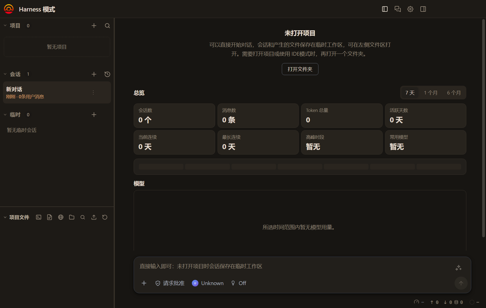

# Msun Harness

Windows 桌面客户端，提供全宽对话的 Harness 模式和内嵌编辑器的 IDE 模式。

安装包见本库 [Releases](https://github.com/Z111F/Msun-Harness/releases)：

- 免安装版：`Msun-Harness-Portable-<版本>-x64.zip`
- 安装版：`Msun-Harness-Setup-<版本>-x64.exe`
- 校验：同一 Release 附 `SHA256SUMS.txt`（SHA-256）

操作手册：[客户端操作手册（PDF）](<Msun Harness 客户端操作手册.pdf>)

本库由 Msun Harness 项目创建并维护，用于发布客户端安装包、操作手册与更新说明。
